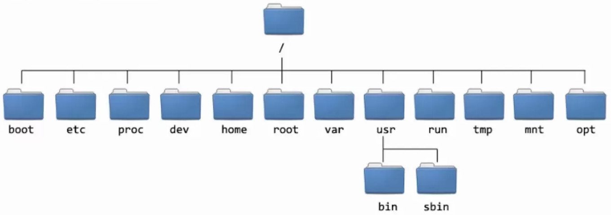

# Graphics in R
## Visualizing Data

Data visualization is one of the most commonly used tools by scientists
to communicate with each other and with the public. Often, looking at
raw numbers makes comparing them or recognizing trends difficult. Graphs
are a powerful way to convey information from complex datasets, and are
key to understand datasets and direct their analysis. Virtually every
statistical software package has at least some graphing functionalities,
yet they are often not flexible, and limited to a few plot types.
Considering research goals and the data used to achieve them can vary
widely, successful graphical data analysis often requires flexible
graphing strategies. Computer languages that allows us to manipulate
many aspects of a graph are a great way to attain this flexibility.

R is well known for its vast repertoire of graphing functionalities. A
basic installation of R ships with a series ofr graphical functions
known as the \"base\" graphics functions. Many packages wrap these
functions into more complex ones to plot more involved figures, such as
phylogenies or maps. In addition, several packages have been developed
to produce graphs in different ways, such as `lattice`, and the popular
`ggplot` package. Other computer languages also have very good plotting
functionalities, such as the `Matplotlib` and `Plotly` modules in
Python.

Today we will cover R's \"base\" plotting functions. As their name
suggests, these are the most \"basic\" plotting functions in R. This
makes building complex graphs a more involved endeavor, since more
things need to be specified, but has the advantage that we have more
control over the final look of our plots, precisely because we can
specify more aspects of the plots. We will focus on how to build and
modify single and multi-panel plots.

## A single plot

`R` plots are modular: We can build a plot and add elements on top of
it, and we can combine multiple plots into a complex multi-panel figure.
We will begin with a somewhat in-depth exploration of single plots and
their elements, and will then move on to multiple plots.

### Barplots

A barplot depicts a single numerical variable by plotting bars with the
height proportional to each element of that variable. They are often
used to depict attributes of several groups, for example counts or
average values of different categories. LEts create a barplot with the
areas of different continents

``` R
    areas <- c(11506, 5500, 16988, 2968, 3745, 9390, 6795)
    barplot(areas)
```

This produces a plot, but it is missing the names of each bar. One way
to do this, is by assigning names to each element in our vector, which
can be achieved in a similar way to name assignment for data frames and
matrices.

``` R
    # Assign names
    names(areas) <- c("Africa", "Antarctica", "Asia",
        "Australia", "Europe", "North America",
        "South America")

    # Plot
    barplot(areas)
```

An alternative way to assign names is to use the
`names` argument in
`barplot()`.

``` R
    # Specify names directly
    barplot(areas,
        names=c("Af", "Ant", "As", "Au", "Eu", "NA", "SA"))
```

We can pass additional arguments to add axis labels
(`xlab`,
`ylab`), a title
(`main`), and to make the bars pink
(`col`).

``` R
    barplot(areas,
         names=c("Af", "Ant", "As", "Au", "Eu", "NA", "SA"), 
         xlab="Land Mass", ylab="Area", 
         main="Area of Continents", 
         col="pink")
```

We can even remove the black border (or change its color) if we don't
like the way it looks.

``` R
    barplot(areas,
         names=c("Af", "Ant", "As", "Au", "Eu", "NA", "SA"), 
         xlab="Land Mass", ylab="Area", 
         main="Area of Continents", 
         col="pink", border=NA)
```

Or plot horizontal bars

``` R
    # Horizontal bar plot. 
    # Note how x and y axis labels were switch to reflect new orientation. 
    barplot(areas, horiz=TRUE
         names=c("Af", "Ant", "As", "Au", "Eu", "NA", "SA"), 
         xlab="Area", ylab="Land Mass", 
         main="Area of Continents", 
         col="pink", border=NA)
```

We also color bars with different colors. For instance, lets plot the
petal length of multiple individuals of different *Iris* species, and
color them by species.

``` R
    # Load iris dataset
    data(iris)

    # Plot, color by species
    barplot(iris$Petal.Length, 
        col=iris$Species, border=NA, space=F, 
        ylab="Petal Length (mm)", xlab="Individuals")
```

Note how we used a variable to pass one value for the color of each bar.
Because this variable is a factor, R will internally transform it into a
number, which is then matched to a color. Colors can be passed as names,
numbers, RGB (red green and blue) values, or [hex
codes](https://en.wikipedia.org/wiki/Web_colors). We will cover this in
more depth below.

### Scatterplots

It is very common to plot the relationship between two (or more)
variables. In fact, we just did this in the last example: We plotted the
relationship between petal length (bar heights) and species (bar
colors). If we want to plot two continuous variables we can produce a
*scatterplot* using the `plot()`
function. Lets plot sepal length vs. sepal width for the *Iris* dataset.

``` R
    plot(iris$Sepal.Length, iris$Sepal.Width, 
        xlab="Sepal Length (mm)", ylab="Sepal Width (mm)")
```

### Plotting symbols and colors

We can customize the appearance of scatterplots in multiple ways. For
instance, we can change the symbol used for plotting, and the color of
those symbols.

``` R
    plot(iris$Sepal.Length, iris$Sepal.Width, 
        xlab="Sepal Length (mm)", ylab="Sepal Width (mm)",
        col="blue", pch="15")
```

Plotting symbols are set with the
`pch` argument, which takes a
number from 0-26, each corresponding to a different symbol (Fig. 1).

<figure id="pch" data-latex-placement="!ht">
<div class="centering">
<embed src="pch.png" style="width:8cm" />
</div>
<figcaption>Figure 1. Plotting symbols available through the <code>pch</code>
argument</figcaption>
</figure>

<figure data-latex-placement="ht">

<figcaption>Example directory structure of a Linux system.</figcaption>
</figure>

The color of plotting symbols is controlled with the
`col` argument. In most cases, this
controls the color of the entire symbol. However, symbols 21-25 allow
for different border and background (i.e. fill) colors, controled with
the `col` and
`bg` arguments, which can be
helpful when we have many points and.

``` R
    plot(iris$Sepal.Length, iris$Sepal.Width, 
        xlab="Sepal Length (mm)", ylab="Sepal Width (mm)",
        pch=21, col="black", bg="pink")
```

The `cex` argument controls the
size of things through <u>c</u>haracter <u>ex</u>pansion.
That is, it expands or contracts the sizes of points, text, etc\... by a
factor provided by the user. For instance, if we wanted to make the
points in our previous plot 1.5 times bigger:

``` R
    plot(iris$Sepal.Length, iris$Sepal.Width, 
        xlab="Sepal Length (mm)", ylab="Sepal Width (mm)",
        pch=21, col="black", bg="pink", cex=1.5)
```

Or half as big

``` R
    plot(iris$Sepal.Length, iris$Sepal.Width, 
        xlab="Sepal Length (mm)", ylab="Sepal Width (mm)",
        pch=21, col="black", bg="pink", cex=0.5)
```

We can use the `type` argument to
control whether lines connect each point in our plot, which can be
useful for plotting time series or other data where depicting rates of
change or connecting consecutive points is desirable.

``` R
    # Plot a wave function as points (default)
    # the same result can be achieved with pch="p"
    x <- seq(0, 36, 0.5)
    plot(x, cos(x), pch=16) 

    # Points connected by lines
    plot(x, cos(x), pch=16, type="b")

    # Just lines
    plot(x, cos(x), pch=16, type"l")

    # Don't plot symbols (but create plot)
    plot(x, cos(x), pch=16, type"n")
```

Colors, sizes, and plotting symbols can be specified for each point in a
scatter plot (similar to colors for a bar plot). For instance, we can
color our *iris* plot by species.

``` R
    plot(iris$Sepal.Length, iris$Sepal.Width, 
        xlab="Sepal Length (mm)", ylab="Sepal Width (mm)",
        pch=21, col="black", bg=iris$Species, cex=1.5)
```

The trick of passing colors for each point based on a factor is useful
(and a similar trick can be used to control `pch` or `cex`), but can be
limited, for instance if we want to use other colors or symbols. We can
automatically create vectors with colors, plotting symbols or sizes for
each point using conditionals or other programming functions.

For instance, lets assign colors and symbols by species. First, lets use
`levels()` to find out what species
are in our data, and then we will use the
`==` operator to assign colors and
symbols to each point.

``` R
    # print out levels of iris$Species
    levels(iris$Species)
    [1] "setosa"     "versicolor" "virginica" 

    # Create "empty" vectors for colors and symbols
    colors <- rep(NA, nrow(iris))
    symbols <- rep(NA, nrow(iris))

    # Populate the vectors
    colors[iris$Species == "setosa"] <-"gold"
    colors[iris$Species == "versicolor"] <-"darkgreen"
    colors[iris$Species == "virginica"] <-"orchid"

    symbols[iris$Species == "setosa"] <- 21
    symbols[iris$Species == "versicolor"] <- 22
    symbols[iris$Species == "virginica"] <- 23

    # Plot
    plot(iris$Sepal.Length, iris$Sepal.Width, 
        xlab="Sepal Length (mm)", ylab="Sepal Width (mm)",
        pch=symbols, col="black", bg=colors, cex=1.5)

    # Add a legend 
    legend(x=6.95, y=4.45, 
        c("I. setosa", "I. versicolor", "I. virginiana"),
        pch=c(21, 22, 23), cex=1.4,
        col="black", pt.bg=c("gold", "darkgreen", "orchid"))
```

We will not go into the `legend()`
function in the interest of time, but it is worth noting that it allows
us to customize legends to a great degree. This function only needs us
to specify the location of the legend on the plot, and the text that
should be displayed, but we can display lines, points, generic squares,
additional text, etc\... and adjust their sizes, and fonts, among
others. A great place to start learning more about legends in base R is
`?legend`.

#### Specifying colors

Until now, we have been specifying colors by names. R can take a very
long list of color names, many of which can be found in the
[r-charts](https://r-charts.com/colors/) website. This being said,
computers can generate many more colors than humans can name, especially
when we consider attributes such as transparency. R allows us to pass
exact colors in two ways, either as a combination of red-green, and blue
(i.e. RGB) values, or using the colors' hex codes. For instance

``` R
    plot(iris$Sepal.Length, iris$Sepal.Width, 
        xlab="Sepal Length (mm)", ylab="Sepal Width (mm)",
        pch=21, col="black", bg=rgb(1,0,0), cex=1.5)
```

Here, we passed a color that is just red (R = 1, G = 0, B = 0), which is
equivalent to the color named \"red\". Using this function we can
generate every possible color that a computer is able to render, which
can be very useful if, for instance, we need to match colors across
figures generated in different programs. If you want to find the RGB
values for a named color, you can use
`col2rgb("name")`. Hex codes are an
alternate way to represent RGB values that is commonly used in web
development. The hex code for \"red\" is #FF0000. R can also read hex
values when setting colors for plots.

A useful feature of the `rgb()`
function is that it allows us to pass a *color opacity* value, often
known as `alpha`. These values also range from 0-1, with 0 being fully
transparent and 1 fully opaque. This can be useful for example if we're
plotting overlaid elements, such as the points in the iris plot.

``` R
    # Set transparent colors (alpha = 0.5)
    # rgb(R, G, B, alpha)
    colors[iris$Species == "setosa"] <-rgb(1,0,0.854, 0.5) 
    colors[iris$Species == "versicolor"] <-rgb(0.84,0.39,0.44, 0.5)
    colors[iris$Species == "virginica"] <-rgb(0,0,0.84, 0.5)

    # Plot
    plot(iris$Sepal.Length, iris$Sepal.Width, 
        xlab="Sepal Length (mm)", ylab="Sepal Width (mm)",
        pch=symbols, col="black", bg=colors, cex=1.5)
```

Note that there are functions that take a color name and internally
convert it to RGB, add an alpha value, and return the new color as a hex
or RGB code, such as `alpha()` in
the package `scales`. Of course, you can always write your own function
if you'd rather not install a full package. See an example
[here](https://gist.github.com/mages/5339689).

### Labels and text

We can modify the text elements in our plots from the
`plot()` function (and its
relatives). We have already modified the text of the axis labels, but
there is much more we can do. For instance, we can change the size of
the axis labels and the axis tick labels using the
`cex.lab` and
`cex.axis` parameters, and change
the size of the plot title with
`cex.main`.

``` R
    # Plot a wave function
    x <- seq(0, 16, 0.5)
    plot(x, cos(x), pch=16, cex.lab=2, cex.axis=1.2,
        main="Cosine of x", cex.main=3) 
```

We can also add text directly within our plots using the
`text()` function.

``` R
    # Annotate plot
    text(9, 0.75, "y = cos(x)", cex=1.5)
```

The `expression()` function lets us
include additional symbols and text formats (e.g. subscripts and
superscripts).

``` R
    # Plot a wave function, x axis in units of pi
    x <- seq(0, 16, 0.5)
    plot(x/pi, cos(x), pch=16, cex.lab=1.5, cex.axis=1.2,
            xlab=expression(theta), ylab=expression(cos(theta))) 
```

We can stitch multiple expressions and words together using
`paste()`

``` R
    # Plot a wave function, x axis in units of pi
    x <- seq(0, 16, 0.5)
    plot(x/pi, cos(x), pch=16, cex.lab=1.5, cex.axis=1.2,
            xlab=expression(paste(theta, "in units of", pi, sep=" ")), ylab=expression(cos(theta)))

    # Throw in some more math notation
    text(3, 0.75, 
        expression(paste(cos^2, (theta) == frac(1, 2))),
        cex=1.5)
```

### Adding shapes and curves

In addition to text, we can plot additional points, shapes, or even
lines and curves on our plot. Below we will cover the
`points()`,
`abline()`, and ,
`lines()` functions to do so. These
are only a few of the many functions that can be used to add to existing
plots. Other include `curve()`,
`polygon()`,and
`arrows()`.

``` R
    # Plot a the cosine, x axis in units of pi
    x <- seq(0, 16, 0.5)
    plot(x/pi, cos(x), pch=16, cex.lab=1.5, cex.axis=1.2,
            xlab=expression(theta), ylab=expression(cos(theta))) 

    # Add the sine function with points
    points(x/pi, sin(x), pch=16, col="red")

    # Add a horizontal line at 0
    # lty=2 specifies the line type is dashed
    abline(h=0, lty=2)
```

We can use this same approach, for instance, to add a regression line to
a scatter plot.

``` R
    # Plot
    plot(iris$Petal.Length, iris$Petal.Width, 
        xlab="Petal Length (mm)", ylab="Petal Width (mm)",
        pch=symbols, col="black", bg="grey", cex=1.5)

    # perform simple linear regression
    reg <- lm(iris$Petal.Width~iris$Petal.Length)

    # Add regression line
    abline(coef(reg), col="red")
```

For more complex lines, the
`lines()` function can be useful.
It works similar to `points()`, but
plots a line connecting the provided coordinates instead of points.

``` R
    # Plot a the cosine, x axis in units of pi
    x <- seq(0, 16, 0.5)
    plot(x/pi, cos(x), pch=16, cex.lab=1.5, cex.axis=1.2,
            xlab=expression(theta), ylab=expression(cos(theta))) 

    # Add a line with the same function. 
    x2 <- seq(0, 16, 0.01)

    lines(x2/pi, cos(x2))
```

### Axis scales

R calculates the upper and lower limits of axes by default. If needed,
we can modify them using `xlim` and
`ylim`.

``` R
    # Plot a the cosine, x axis in units of pi
    x <- seq(0, 16, 0.5)

    #New plot with x axis from -1 to 6 and y axis from 0 to 1
    plot(x/pi, cos(x), pch=16, cex.lab=1.5, cex.axis=1.2,
            xlab=expression(theta), ylab=expression(cos(theta)),
            xlim=c(-1, 6), ylim=c(0, 1)) 
    lines(x2/pi, cos(x2))
```

### Summary plots

Until now, we have plotted raw data. However, statisticians often plot
summaries of the data, for instance to visualize its distribution. Two
commonly used plots to this end are histograms and box plots, both of
which describe the distribution of a single numerical variable, but can
be overlain to compare more than one variable. We will use them to
explore the distribution of sepal widths in the iris dataset below.

#### Histograms

Histograms can be obtained with the
`(`hist) function.

``` R
    hist(iris$Petal.Width, 
        xlab="Petal Width (mm)", main="", 
        col="black", border="white")
```

We can see there is a clear bimodal distribution. How about we plot each
species separately

``` R
    # Create separate vectors for each species 
    set <- iris$Petal.Width[iris$Species=="setosa"]
    vers <- iris$Petal.Width[iris$Species=="versicolor"]
    vir <- iris$Petal.Width[iris$Species=="virginica"]

    # Plot setosa with expanded xlab so they all fit
    # Use transparent colors to accomodate overlap
    hist(set, 
        xlab="Petal Width (mm)", main="", 
        col=rgb(1,0,0.854, 0.5),, xlim=c(0,2.5))
    # Plot second histogram. 
    # Use add=T to add to the same plot. 
    hist(vers, 
        xlab="Petal Width (mm)", main="", 
        col=rgb(0.84,0.39,0.44, 0.5), xlim=c(0,2.5),
        add=T)
    # Third species
    hist(vir, 
        xlab="Petal Width (mm)", main="", 
        col=rgb(0,0,0.84, 0.5), xlim=c(0,2.5),
        add=T)
```

This looks OK, but the bins in one of the species are wider than the
other two, which makes comparison difficult. We can use the
`breaks` argument to set the same
bin width for all sets.

``` R
    # Plot setosa with expanded xlab so they all fit
    # Use transparent colors to accomodate overlap
    hist(set, 
        xlab="Petal Width (mm)", main="", 
        col=rgb(1,0,0.854, 0.5),, xlim=c(0,2.5), 
        breaks=seq(0, 2.5, 0.1))
    # Plot second histogram. 
    # Use add=T to add to the same plot. 
    hist(vers, 
        xlab="Petal Width (mm)", main="", 
        col=rgb(0.84,0.39,0.44, 0.5), xlim=c(0,2.5),
        breaks=seq(0, 2.5, 0.1), add=T)
    # Third species
    hist(vir, 
        xlab="Petal Width (mm)", main="", 
        col=rgb(0,0,0.84, 0.5), xlim=c(0,2.5),
        breaks=seq(0, 2.5, 0.1), add=T)
```

### Boxplots

An alternative way to visualize the same pattern is using box plots.
Briefly, a box plot depicts the range, median, and interquartile range
of a numerical variable. the
`boxplot()` function allows us to
easily visualize the distribution of multiple groups alongside each
other. These groups can be passed individually to the function, or they
can be specified using a grouping variable (i.e. a factor).

``` R

    boxplot(set, vers, vir, 
        names=c("I. set", "I. vers", "I. vir"), 
        col=c("gold", "darkgreen", "orchid"), 
        xlab="Species", ylab="Petal Width(mm)")

    #Specify groups by grouping variable 

    boxplot(iris$Petal.Width~iris$Species,
        col=c("gold", "darkgreen", "orchid"), 
        xlab="Species", ylab="Petal Width(mm)" )
```

### A note on `plot()`

We have used the `plot()` function
only to plot two continuous variables alongside each other. However,
this function is able to recognize the data types it receives, and
attempts to guess the best plot type. For instance, we could recreate
the box plot above using
`plot(iris$Species, iris$Petal.Width ...)`.
Many data types come with specific instructions for plotting, which let
`plot()` know what to do for that
specific data type. This includes data types to handle maps,
phylogenetic trees, sequence alignments, survival tables, and even the
output of statistical tests (try
`plot(reg)` to generate diagnostic
plots for the linear regression we ran, for example), and many other
biologically-relevant data types.

## Multi-panel Figures

We have spent most of today learning how to plot individual figures.
However, one of R's most powerful graphical utilities is the ability to
generate complex multi-panel plots. Researchers will often create each
panel of a complex plot, and then join them manually on an image editor
(or even a slideshow editor such as powerpoint!). This can take a
considerable amount of time, and is not very repeatable. We will
therefore cover one of the basic ways to create multi panel plots in R.

### Symmetric pannels: `par(mfrow)`

If we need multiple panels of the same size that can be arranged on a
grid, we can use the `par()`
function to change the number of panels within our plotting window. This
function takes two arguments: the number of rows and columns of our
plotting window, and generates a rectangular grid of panes based on
these. For instance, lets plot the three histograms we generated above,
but each in their own window. As a bonus, we can use the
`mtext()` function to label each
panel as A-C.

``` R
    #Set panel grid. 
    par(mfrow=c(2,2))

    #First panel
    hist(set, 
        xlab="Petal Width (mm)", main="", 
        col=rgb(1,0,0.854, 0.5),, xlim=c(0,2.5), 
        breaks=seq(0, 2.5, 0.1))
    mtext("A.", side=3, adj=-0.3, line=0.3, cex=1.5)
    # Plot second histogram. 
    hist(vers, 
        xlab="Petal Width (mm)", main="", 
        col=rgb(0.84,0.39,0.44, 0.5), xlim=c(0,2.5),
        breaks=seq(0, 2.5, 0.1))
    mtext("B.", side=3, adj=-0.3, line=0.3, cex=1.5)
    # Third species
    hist(vir, 
        xlab="Petal Width (mm)", main="", 
        col=rgb(0,0,0.84, 0.5), xlim=c(0,2.5),
        breaks=seq(0, 2.5, 0.1))
    mtext("C.", side=3, adj=-0.3, line=0.3, cex=1.5)
```

Above we used a $2 \times 2$ grid. If we wanted, for instance, a single
row of three panels, we could specify
`par(mforw=c(1,3)`.

1,3), nr=2, nc=2)

## Saving Plots for Further Editing

R allows us to code up publication-ready figures that are completely
repeatable, and that we can revise and reuse in future projects, or when
new data comes along. However, in some cases we may still want to edit
our figures on an image editor. R offers the possibility to save figures
as *vector* images, which means that, instead of pixels, they are made
up of a series of lines and objects that can be manipulated
independently. Figures save by R in formats such as `.svg`, `.eps`, and
`.pdf` can then be opened in popular graphics editors, such as Inkskape
(open source) or Adobe Illustrator (paid subscription), so it is
advisable to always save figures in these formats, and then convert
these files to pixel images (e.g. `.jpg` or `.png`) if needed.

## Final Problems

Answer the following questions in a *single markdown-formatted document*
within a folder in your GitHub repository (e.g. `Practicals/W11/`). Add
any scripts and other files you create to the folder as well. **Include
all your code, as well as an explanation of what it does in your
answers.**

### `pch` Symbols

The [r-charts](https://r-charts.com/base-r/pch-symbols/) website has an
explanation of how to generate Figure 1 using R. Their way code makes
use of the `expand.grid()`
function. Write a script that replicates this figure *without* using
`expand.grid()`. Include the figure
in your markdown document.

### Recreate a figure

The scientific literature is, of course, full of figures. Some are very
good and beautiful, while others could have reperesented the exact same
data in a much better way. Find a figure in a scientific paper of your
choice that makes their data freely available.

1.  If this is a figure that you like and find informative and easy to
    understand, try to recreate it as closely as possible in R.

2.  If, on the contrary, you think this figure is not great, re-create
    an improved version.

In your answer include both the original and your recreated figure (and
a citation of the original source), and an explanation of why you think
this is a good/bad figure, and, if bad, how you improved it and why.
